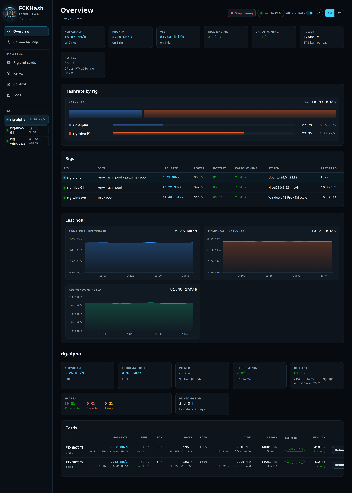

# FCKHash

**English** · [Português (Brasil)](README.pt-BR.md)

Formerly fear-miner: same miner, same settings. FCKHash 1.0.0 follows fear-miner 1.6.8.

Multi-algorithm NVIDIA GPU miner. Packages for HiveOS, Linux and Windows.

## Coins

Pick your coin. Its page has the pool and wallet settings, the cards it supports and its own
options.

| Coin | Algorithm | Cards | Docs |
| --- | --- | --- | --- |
| Keryx | `keryxhash` | NVIDIA Turing or newer, 8 GB or more | [coins/keryx](coins/keryx/README.md) |
| Vela | `vela` | NVIDIA Turing or newer | [coins/vela](coins/vela/README.md) |
| Proxima | `proxima` | NVIDIA Turing or newer (standalone or dual with Keryx on RTX 50) | [coins/proxima](coins/proxima/README.md) |
| NEB | `neb` | NVIDIA Turing or newer | [coins/neb](coins/neb/README.md) |
| Numen | `numen` | NVIDIA Turing or newer | [coins/numen](coins/numen/README.md) |
| Vearl (testnet) | `vearl` | NVIDIA Turing with tensor cores, or newer | [coins/vearl](coins/vearl/README.md) |

> [!WARNING]
> **Keryx:** the H16 hard fork activates on 2026-11-07. From then on versions before 1.6.0 are invalid.
> See [coins/keryx](coins/keryx/README.md).

## Download: 1.0.1 (2026-11-21)

One package per platform. It mines every coin in the table above.

| Platform | File | Install guide |
| --- | --- | --- |
| HiveOS | [fckhash-1.0.1.tar.gz](https://github.com/fearke85/fckhash-miner/releases/download/v1.0.1/fckhash-1.0.1.tar.gz) | [docs/en/hiveos.md](docs/en/hiveos.md) |
| Linux | [fckhash-linux-1.0.1.tar.gz](https://github.com/fearke85/fckhash-miner/releases/download/v1.0.1/fckhash-linux-1.0.1.tar.gz) | [docs/en/linux.md](docs/en/linux.md) |
| Windows | [fckhash-windows-1.0.1.zip](https://github.com/fearke85/fckhash-miner/releases/download/v1.0.1/fckhash-windows-1.0.1.zip) | [docs/en/windows.md](docs/en/windows.md) |

What changed: [release notes](https://github.com/fearke85/fckhash-miner/releases/tag/v1.0.1) ·
[CHANGELOG](CHANGELOG.md). Checksums are on the release page.

## Getting started

1. Choose your coin in the table above and note its pool, wallet and algorithm settings.
2. Install the package for your platform with its guide: [HiveOS](docs/en/hiveos.md),
   [Linux](docs/en/linux.md) or [Windows](docs/en/windows.md).
3. Open the built-in **Web Panel** at `http://RIG-IP:4455` (or **FCKHash Panel** in your app menu)
   to configure your coin, pool, wallet, overclock and connected rigs, or check the HiveOS dashboard
   / `curl 127.0.0.1:4060/stats`.

## Built-in Web Panel & Multi-Rig Hub

Every rig serves a web panel on port `4455`, in English and Portuguese, with a 5-step setup wizard,
30-day history charts, live manual and automatic overclock, Keryx AI request monitoring, LAN rig
auto-discovery, one-click farm updates, Tailscale phone app install and one-click diagnostic log
export.

Full visual guide: **[Web Panel & Multi-Rig Hub](docs/en/panel.md)**

## Requirements for every coin

- An NVIDIA card the coin supports (see its page).
- NVIDIA driver 580 or newer (CUDA 13.2). The packages bring the CUDA libraries, not the driver.
- HiveOS on the Ubuntu 22.04 (jammy) image, Linux with glibc 2.35 or newer, or Windows 10 / 11.

## Documentation

| Topic | For every coin | Keryx | Vela | Proxima | NEB | Numen | Vearl |
| --- | --- | --- | --- | --- | --- | --- | --- |
| Install | [HiveOS](docs/en/hiveos.md) · [Linux](docs/en/linux.md) · [Windows](docs/en/windows.md) | [Settings](coins/keryx/README.md#settings) | [Settings](coins/vela/README.md#settings) | [Settings](coins/proxima/README.md#settings) | [Settings](coins/neb/README.md#settings) | [Settings](coins/numen/README.md#settings) | [Settings](coins/vearl/README.md#settings) |
| Web Panel | [Panel & Hub guide](docs/en/panel.md) | [Keryx AI view](docs/en/panel.md#coin-view-keryx-ai-requests--tiers) | | [Dual setup](docs/en/panel.md#control-live-manual-overclock--auto-oc) | | | |
| Options | [Miner options](docs/en/options.md) | [Keryx options](coins/keryx/docs/en/options.md) | [Vela options](coins/vela/README.md#vela-options) | [Proxima options](coins/proxima/README.md#proxima-options) | [NEB options](coins/neb/README.md#neb-options) | [Numen options](coins/numen/README.md#numen-options) | [Vearl options](coins/vearl/README.md#vearl-options) |
| Problems | [Troubleshooting](docs/en/troubleshooting.md) | [Keryx problems](coins/keryx/docs/en/troubleshooting.md) | [Vela problems](coins/vela/README.md#troubleshooting) | | [NEB problems](coins/neb/README.md#troubleshooting) | [Numen problems](coins/numen/README.md#troubleshooting) | [Vearl problems](coins/vearl/README.md#troubleshooting) |
| Solo mining | | [Keryx solo](coins/keryx/docs/en/solo.md) | [Vela solo](coins/vela/README.md#solo-on-your-own-node) | [Proxima solo](coins/proxima/README.md#solo-with-your-own-proxima-node-proxi-node-mine) | [NEB solo](coins/neb/README.md#solo-on-your-own-neb-node) | [Numen solo](coins/numen/README.md#solo-through-rplant) | [Vearl solo](coins/vearl/README.md#solo) |

## Community tools

[Juliano Caju](https://www.julianocaju.com.br/en/calculator/) has tools for several coins, in
English and Portuguese:

- [Overclock table](https://www.julianocaju.com.br/en/overclocks/) per card and coin
- [Mining calculator](https://www.julianocaju.com.br/en/calculator/)
- [Profitability per card](https://www.julianocaju.com.br/en/profitability/)

## Help

- [Discord](https://discord.gg/uK93NPAhbd)
- [Open an issue](https://github.com/fearke85/fckhash-miner/issues/new/choose) and attach `log.txt`

## License

FCKHash is proprietary. The [LICENSE](LICENSE) allows use of the unmodified software only.
Modification, extraction and attempts to break the protected encoding are prohibited.
Third-party components in the package are listed in [NOTICE](NOTICE). This repository publishes
the release archives and the documentation. It does not publish source code.
