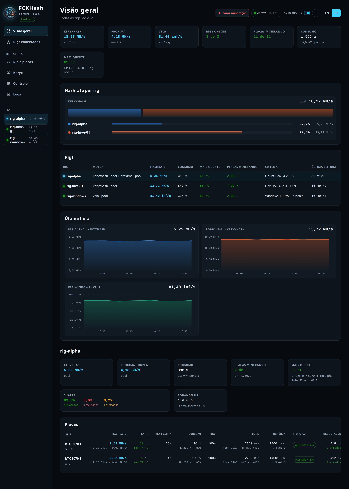

# FCKHash

[English](README.md) · **Português (Brasil)**

Antes chamado fear-miner: o mesmo miner, as mesmas configurações. A FCKHash 1.0.0 vem depois da fear-miner 1.6.8.

Miner multi-algoritmo para GPUs NVIDIA. Pacotes para HiveOS, Linux e Windows.

## Moedas

Escolha a sua moeda. A página dela tem as configurações de pool e carteira, as placas suportadas e
as opções próprias.

| Moeda | Algoritmo | Placas | Docs |
| --- | --- | --- | --- |
| Keryx | `keryxhash` | NVIDIA Turing ou mais nova, 8 GB ou mais | [coins/keryx](coins/keryx/README.pt-BR.md) |
| Vela | `vela` | NVIDIA Turing ou mais nova | [coins/vela](coins/vela/README.pt-BR.md) |
| Proxima | `proxima` | NVIDIA Turing ou mais nova (sozinha ou em dual com Keryx nas RTX 50) | [coins/proxima](coins/proxima/README.pt-BR.md) |
| NEB | `neb` | NVIDIA Turing ou mais nova | [coins/neb](coins/neb/README.pt-BR.md) |
| Numen | `numen` | NVIDIA Turing ou mais nova | [coins/numen](coins/numen/README.pt-BR.md) |
| Vearl (testnet) | `vearl` | NVIDIA Turing com tensor cores, ou mais nova | [coins/vearl](coins/vearl/README.pt-BR.md) |

> [!WARNING]
> **Keryx:** o hard fork H16 ativa em 07/11/2026. A partir daí, versões anteriores à 1.6.0 são inválidas.
> Veja [coins/keryx](coins/keryx/README.pt-BR.md).

## Download: 1.0.0 (2026-11-21)

Um pacote por plataforma. Ele minera todas as moedas da tabela acima.

| Plataforma | Arquivo | Guia de instalação |
| --- | --- | --- |
| HiveOS | [fckhash-1.0.0.tar.gz](https://github.com/fearke85/fckhash-miner/releases/download/v1.0.0/fckhash-1.0.0.tar.gz) | [docs/pt-BR/hiveos.md](docs/pt-BR/hiveos.md) |
| Linux | [fckhash-linux-1.0.0.tar.gz](https://github.com/fearke85/fckhash-miner/releases/download/v1.0.0/fckhash-linux-1.0.0.tar.gz) | [docs/pt-BR/linux.md](docs/pt-BR/linux.md) |
| Windows | [fckhash-windows-1.0.0.zip](https://github.com/fearke85/fckhash-miner/releases/download/v1.0.0/fckhash-windows-1.0.0.zip) | [docs/pt-BR/windows.md](docs/pt-BR/windows.md) |

O que mudou: [notas da release](https://github.com/fearke85/fckhash-miner/releases/tag/v1.0.0) ·
[CHANGELOG](CHANGELOG.md) (em inglês). Os checksums estão na página da release.

## Como começar

1. Escolha a sua moeda na tabela acima e anote as configurações de pool, carteira e algoritmo.
2. Instale o pacote da sua plataforma seguindo o guia: [HiveOS](docs/pt-BR/hiveos.md),
   [Linux](docs/pt-BR/linux.md) ou [Windows](docs/pt-BR/windows.md).
3. Abra o **Painel Web** integrado em `http://IP-DA-RIG:4455` (ou o **FCKHash Panel** no menu de
   aplicativos) para configurar moeda, pool, carteira, overclock e rigs conectadas, ou confira no
   painel do HiveOS / `curl 127.0.0.1:4060/stats`.

## Painel Web Integrado e Hub Multi-Rig

Toda rig serve um painel web na porta `4455`, em português e inglês, com assistente de configuração
em 5 passos, gráficos históricos de até 30 dias, overclock manual ao vivo e automático,
monitoramento de pedidos de IA do Keryx, busca automática de rigs na rede local, atualização da farm
com 1 clique, instalação como app no celular via Tailscale e exportação de diagnóstico em 1 clique.

Guia visual completo: **[Painel Web e Hub Multi-Rig](docs/pt-BR/panel.md)**

## Requisitos para todas as moedas

- Uma placa NVIDIA que a moeda suporte (veja a página dela).
- Driver NVIDIA 580 ou mais novo (CUDA 13.2). Os pacotes trazem as bibliotecas CUDA, não o driver.
- HiveOS com a imagem Ubuntu 22.04 (jammy), Linux com glibc 2.35 ou mais nova, ou Windows 10 / 11.

## Documentação

| Assunto | Para todas as moedas | Keryx | Vela | Proxima | NEB | Numen | Vearl |
| --- | --- | --- | --- | --- | --- | --- | --- |
| Instalação | [HiveOS](docs/pt-BR/hiveos.md) · [Linux](docs/pt-BR/linux.md) · [Windows](docs/pt-BR/windows.md) | [Configuração](coins/keryx/README.pt-BR.md#configurações) | [Configuração](coins/vela/README.pt-BR.md#configuração) | [Configuração](coins/proxima/README.pt-BR.md#configuração) | [Configuração](coins/neb/README.pt-BR.md#configuração) | [Configuração](coins/numen/README.pt-BR.md#configuração) | [Configuração](coins/vearl/README.pt-BR.md#configuração) |
| Painel Web | [Guia do Painel e Hub](docs/pt-BR/panel.md) | [Aba Keryx IA](docs/pt-BR/panel.md#aba-exclusiva-da-moeda-keryx-pedidos-de-ia-e-tiers) | | [Mineração dupla](docs/pt-BR/panel.md#controle-overclock-manual-ao-vivo-e-auto-oc) | | | |
| Opções | [Opções do miner](docs/pt-BR/options.md) | [Opções Keryx](coins/keryx/docs/pt-BR/options.md) | [Opções Vela](coins/vela/README.pt-BR.md#opções-do-vela) | [Opções Proxima](coins/proxima/README.pt-BR.md#opções-da-proxima) | [Opções NEB](coins/neb/README.pt-BR.md#opções-da-neb) | [Opções Numen](coins/numen/README.pt-BR.md#opções-do-numen) | [Opções Vearl](coins/vearl/README.pt-BR.md#opções-do-vearl) |
| Problemas | [Solução de problemas](docs/pt-BR/troubleshooting.md) | [Problemas Keryx](coins/keryx/docs/pt-BR/troubleshooting.md) | [Problemas Vela](coins/vela/README.pt-BR.md#problemas) | | [Problemas NEB](coins/neb/README.pt-BR.md#problemas) | [Problemas Numen](coins/numen/README.pt-BR.md#problemas) | [Problemas Vearl](coins/vearl/README.pt-BR.md#problemas) |
| Mineração solo | | [Keryx solo](coins/keryx/docs/pt-BR/solo.md) | [Vela solo](coins/vela/README.pt-BR.md#solo-no-seu-próprio-node) | [Proxima solo](coins/proxima/README.pt-BR.md#solo-no-seu-próprio-node-proxima-proxi-node-mine) | [NEB solo](coins/neb/README.pt-BR.md#solo-no-seu-próprio-node-neb) | [Numen solo](coins/numen/README.pt-BR.md#solo-pela-rplant) | [Vearl solo](coins/vearl/README.pt-BR.md#solo) |

## Ferramentas da comunidade

O site do [Juliano Caju](https://www.julianocaju.com.br/calculadora/) tem ferramentas para várias
moedas, em português e inglês:

- [Tabela de overclocks](https://www.julianocaju.com.br/overclocks/) por placa e moeda
- [Calculadora de mineração](https://www.julianocaju.com.br/calculadora/)
- [Rentabilidade por placa](https://www.julianocaju.com.br/rentabilidade/)

## Ajuda

- [Discord](https://discord.gg/uK93NPAhbd)
- [Abra uma issue](https://github.com/fearke85/fckhash-miner/issues/new/choose) e anexe o `log.txt`

## Licença

O FCKHash é proprietário. A [LICENSE](LICENSE) permite apenas o uso do software sem
modificações. Modificação, extração e tentativas de quebrar a codificação protegida são proibidas.
Os componentes de terceiros do pacote estão listados no [NOTICE](NOTICE). Este repositório publica
os pacotes das releases e a documentação. Ele não publica código-fonte.
