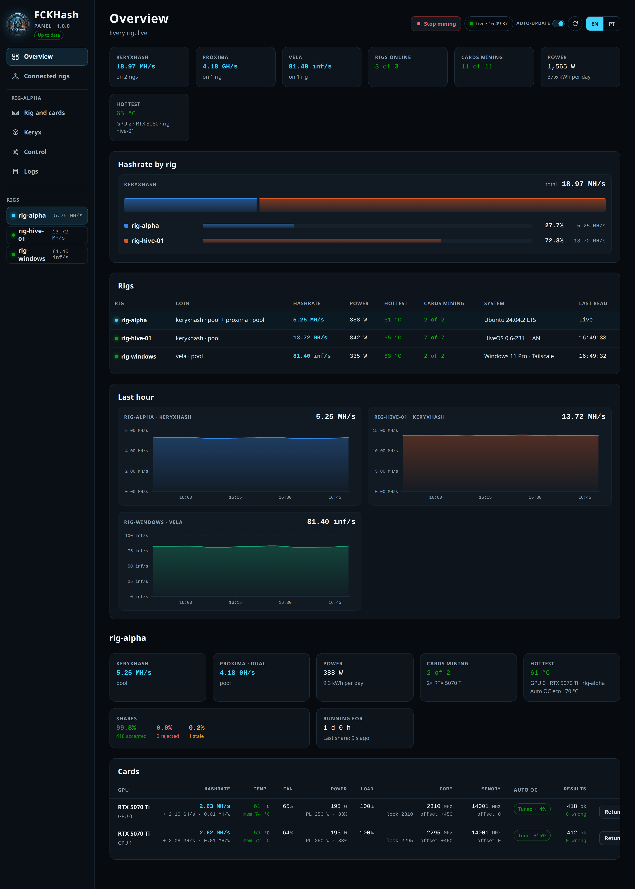
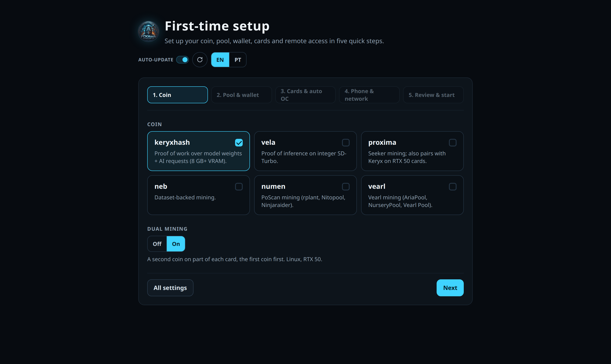
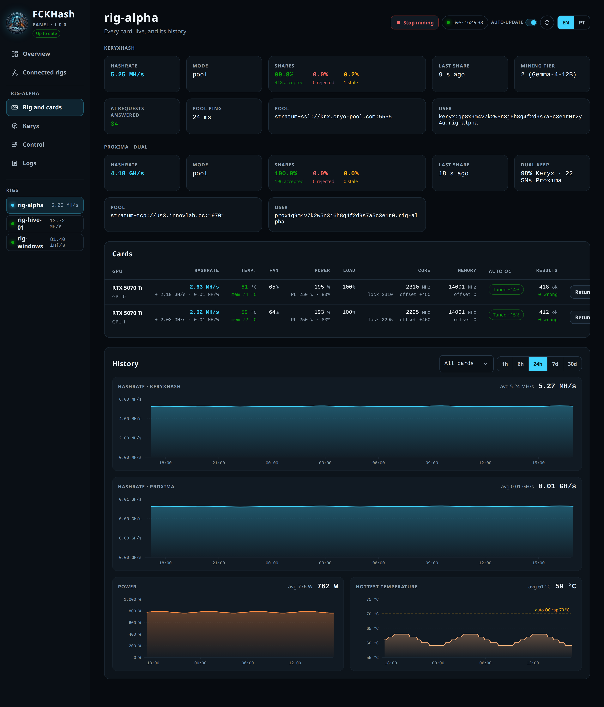
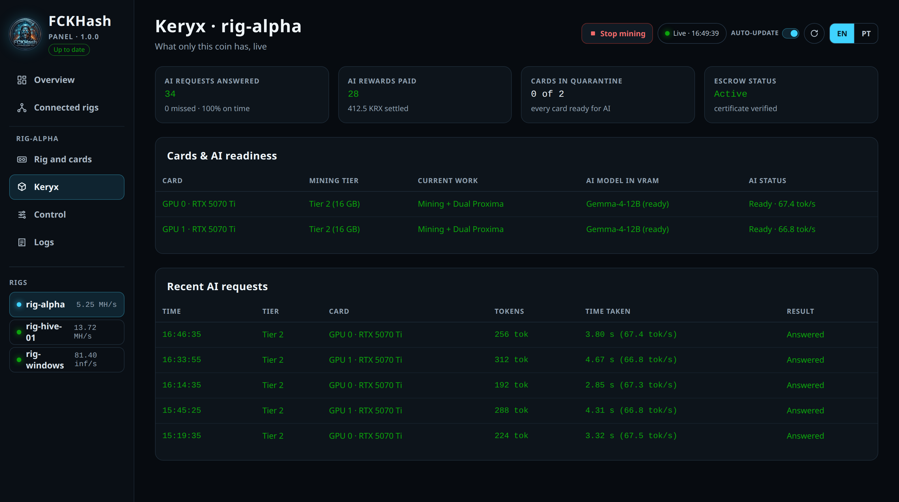
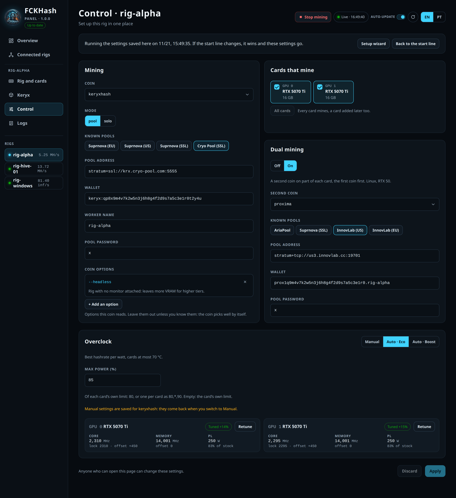
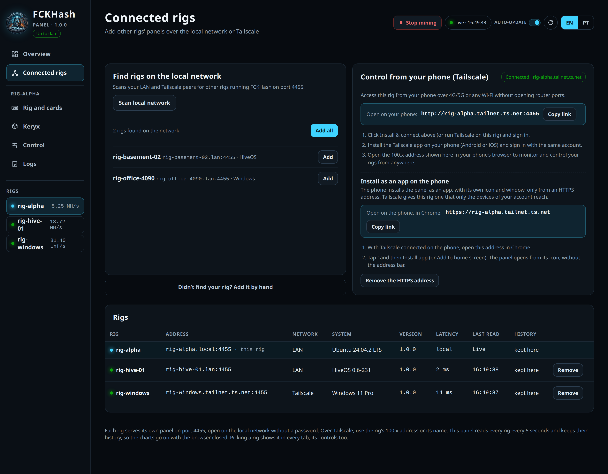
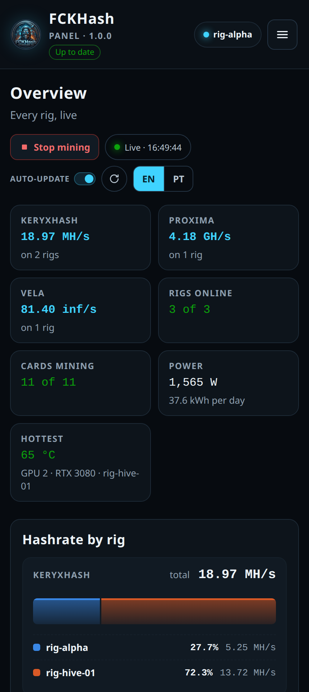
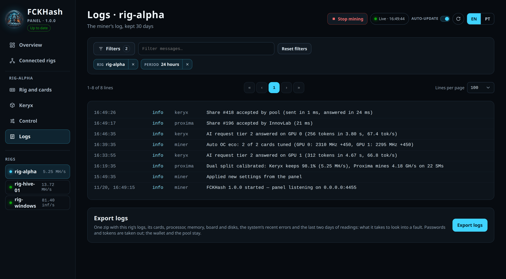

# Web Panel & Multi-Rig Hub

**English** · [Português (Brasil)](../pt-BR/panel.md) · [Back to README](../../README.md)

Every FCKHash rig serves a built-in web panel on port `4455` (`http://RIG-IP:4455`), in English and
Portuguese, with no extra program to install. One rig can follow every other rig on your local
network or Tailscale, keep their history, control their settings and overclock, and install updates
across the whole farm from one browser tab or phone app.

## Opening the panel

- **In any browser on the same network:** open `http://RIG-IP:4455` (or `http://localhost:4455` on
  the rig itself).
- **From the desktop app menu (Linux and Windows):** the first start on a desktop adds **FCKHash
  Panel** to your Linux application menu or Windows Start Menu, and you can also run
  `./fckhash -open` (`fckhash.exe -open` on Windows) to open the panel in its own window.
- **Over Tailscale (4G/5G or any Wi-Fi):** open `http://TAILSCALE-IP:4455` or the rig's Tailscale
  name.
- **Change the address or turn it off:** pass `-panel localhost:4455` to keep it local to the
  machine, or `-panel off` to disable it. See [miner options](options.md).

The panel has no password by default so every device on your network or Tailscale can open it at
once. On a network you share with people you do not trust, close it with `-panel localhost:4455` or
`-panel off`.

---

## First-time Setup Wizard (5 steps)

When you start FCKHash on a new Linux or Windows machine (or press **Setup wizard** in the Control
tab), the 5-step wizard sets the rig up without editing a `.sh` or `.bat` file:

1. **Coin:** pick any supported coin (`keryxhash`, `vela`, `proxima`, `neb`, `numen`, `vearl`) and
   optionally turn on **Dual mining** (`keryxhash` + `proxima` on the same cards).
2. **Pool & wallet:** switch between **Pool** and **Solo**, pick a known pool with one click, and
   enter your payout address and worker name.
3. **Cards & auto OC:** choose which GPUs mine, pick **Auto · Eco**, **Auto · Boost** or **Manual**
   overclock, and set coin-specific options if needed.
4. **Phone & network:** scan your local network to add other rigs and connect Tailscale for phone
   access.
5. **Review & start:** review the summary and press **Start mining**.

---

## Overview & Multi-Rig Farm Hub

When you connect two or more rigs, the **Overview** tab shows your entire farm at the top and the
selected rig below:

- **Farm totals:** total hashrate for each coin across the farm, rigs online, GPUs mining, total
  power draw (W and kWh/day), and the hottest card across all rigs.
- **Hashrate by rig:** a segmented bar showing each rig's share and rate for every coin mined on
  multiple rigs.
- **Rigs table & last hour charts:** live status, coin, hashrate, power, hottest temperature, OS and
  network (`LAN` or `Tailscale`) for every rig, plus an individual 1-hour chart per rig.
- **Alerts with mute:** active warnings and errors appear at the top with a badge count. An alert you
  already know about can be **Muted** (`Mute`), and unmuted later from the muted list; the muted
  list is saved on the rig so your desktop and phone see the same state.
- **Stop / Start mining:** the top bar button stops mining (putting all cards back to their normal
  clocks while keeping the panel online) and starts it again with one click.

---

## Rig & Cards and Historical Charts (up to 30 days)

The **Rig and cards** tab shows the selected rig's live telemetry and long-term history:

- **Live figures per coin:** hashrate, pool/solo mode, accepted/rejected/stale share percentages,
  last share time, pool ping, and dual-mining split when active.
- **Cards table:** every GPU's model, hashrate (both coins in dual mode, plus efficiency), core and
  memory temperatures, fan %, power draw and power limit %, GPU load, core and memory clocks with
  active lock/offset, Auto OC status chip (`Tuned +14%`, `Tuning 12/35`, `Manual`), checked/wrong
  results, and a quick **Retune** or manual **OC** button.
- **Interactive history charts:** switch between **All cards** or a single GPU, and between **1h**,
  **6h**, **24h**, **7d** and **30d**. Readings are recorded every 10 seconds and kept on the rig
  (and copied to any hub rig that follows it), so charts have no gaps even when your browser was
  closed.

---

## Coin View (Keryx AI Requests & Tiers)

Coins with their own live telemetry add a dedicated tab to the sidebar. For **Keryx**, the **Keryx**
tab shows:

- **Summary counters:** AI requests answered, AI rewards paid (in solo), cards in quarantine, and
  escrow status.
- **Cards & AI readiness:** each GPU's mining tier, what it is doing right now, the AI model held in
  VRAM, and its token speed / readiness.
- **Recent AI requests:** the last 30 AI requests with timestamp, tier, GPU, tokens generated, time
  taken and outcome.

---

## Control, Live Manual Overclock & Auto OC

The **Control** tab configures the selected rig from the browser — locally or remotely through the
hub:

- **Mining & Dual mining:** switch coins, pick a known pool preset with one click, edit wallet,
  worker and password, pick which GPUs mine, add or remove coin options from a validated list, and
  configure dual mining (`keryxhash` + `proxima`). Each coin remembers the pool and wallet you
  typed for it when switching back and forth.
- **One Overclock panel with three modes:**
  - **Auto · Eco:** finds the best hashrate per watt on every card (70 °C core limit, memory
    temperature cap on GDDR6X/GDDR7/HBM), with an optional **Max power (%)** cap and per-card
    **Retune** buttons.
  - **Auto · Boost:** tunes for higher hashrate while the extra power still pays (75 °C core limit).
  - **Manual:** set core offset, core lock, memory offset, memory lock, power limit (W) and fan (%)
    for all cards at once or card by card, **saved separately per coin**. When changing the running
    coin's manual overclock while the miner is already in Manual mode, **the new clocks apply to the
    cards immediately without restarting the miner**.
- **Automatic permission prompt on desktop:** on Linux and Windows desktops, if you turn on Auto OC
  or manual clocks without root / Administrator permissions, FCKHash asks for your password or UAC
  confirmation automatically and restarts elevated.
- **HiveOS conflict notice:** on HiveOS, the Control tab checks whether a HiveOS OC profile or
  autofan is active and warns you when it would conflict with the miner's overclock.

---

## Connected Rigs, LAN Auto-Discovery, Tailscale & Farm Updates

The **Connected rigs** tab turns any panel into a multi-rig hub:

- **Find rigs on the local network:** press **Scan local network** to automatically discover other
  rigs running FCKHash on your LAN or Tailscale and add them with **Add** or **Add all**. You can
  also add any rig by IP/hostname and port (`Add a rig by hand`).
- **One-click farm update (`Install on every rig`):** FCKHash checks for a new signed release every
  3 hours (or when you press the refresh button in the top bar). On Linux and Windows, you can turn
  on **Auto-update** in the top bar, press **Install** on one rig, or press **Install on every rig**
  in the Connected rigs tab to update every Linux and Windows rig in your farm at once. Each rig
  waits until no AI request is running, verifies the signed package, and automatically rolls back to
  the previous version if the new one fails to mine. On HiveOS, the panel gives you the new
  Installation URL to copy into your flight sheet.
- **Control from your phone (Tailscale) & Phone App install:** connect Tailscale from the panel and
  press **Create the HTTPS address** to enable `tailscale serve`. Opening that `https://...ts.net`
  address on your phone lets Chrome or Safari install FCKHash Panel as a native-like full-screen app
  on your home screen.

---

## Mobile App View

The panel is built for phones as well as desktops: tables adapt into clean mobile cards, the top bar
gives instant access to **Stop / Start mining** and **Auto-update**, and the drawer switches between
all connected rigs.

  

---

## Logs & One-Click Diagnostic Export

The **Logs** tab shows the last 30 days of logs stored on the rig:

- Filter by **Rig** (single rig or **All rigs** merged), **Period** (1h, 24h, 7d, 30d), **Level**
  (All or Warnings & errors) and **Coin**, or search for text.
- **Export logs:** downloads a single `.zip` with `log.txt`, the 30-day log table, the last 48 hours
  of card and hashrate readings, and hardware diagnostics (CPU, RAM, motherboard, disks,
  `nvidia-smi -q`, recent system GPU/PCIe errors). Passwords, pool tokens and escrow certificates
  are automatically stripped before export.

