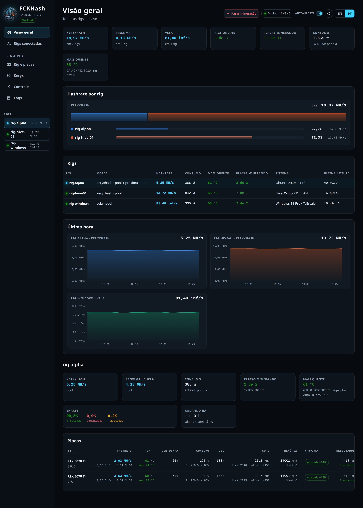
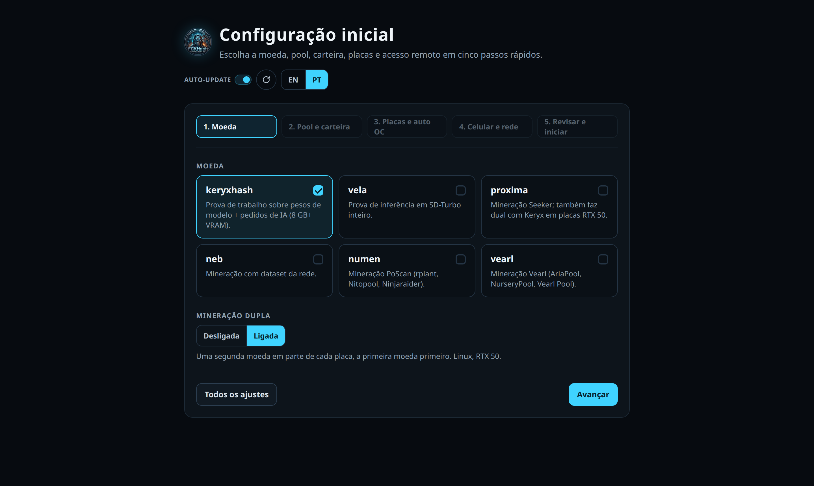
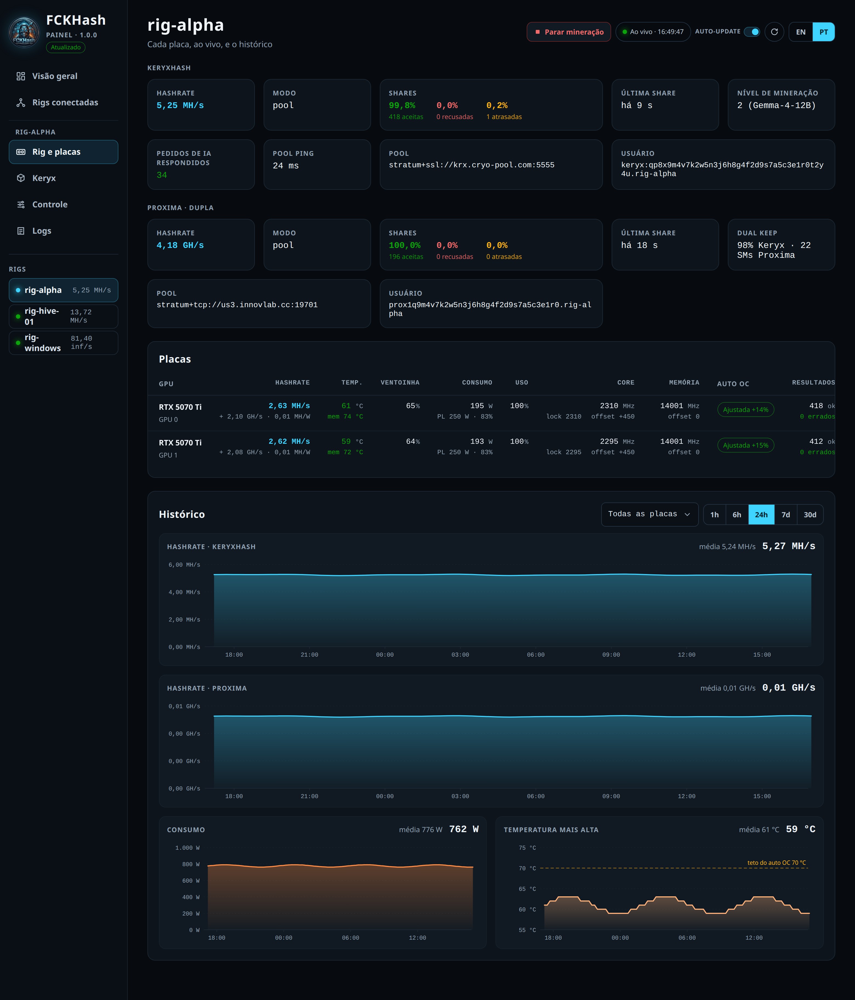
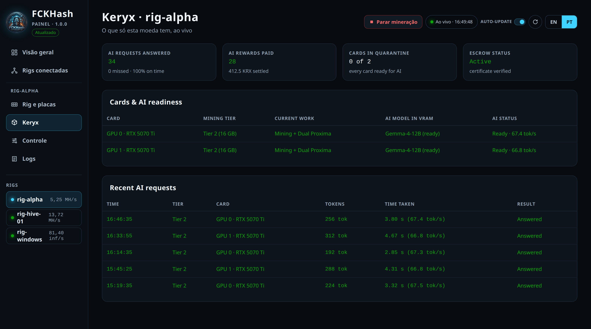
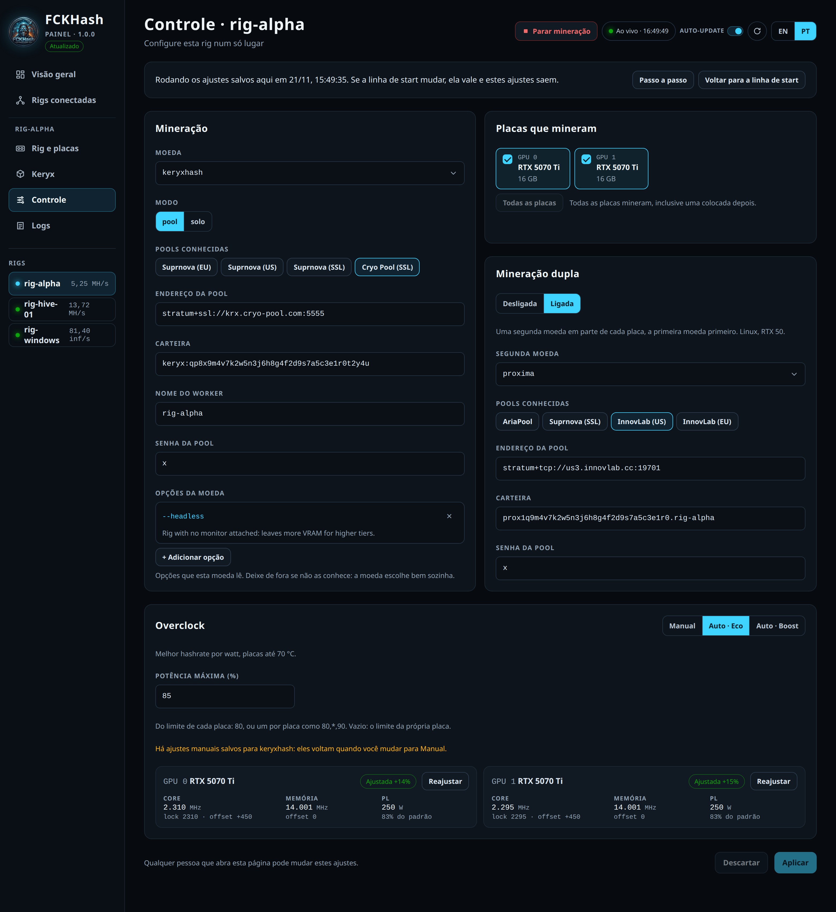
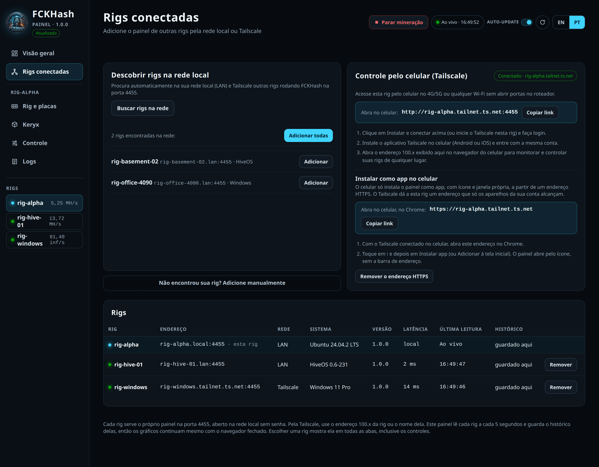
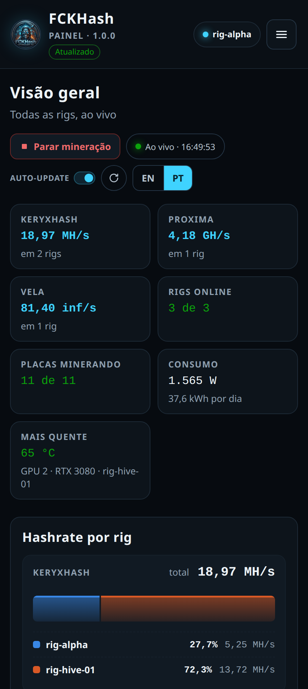
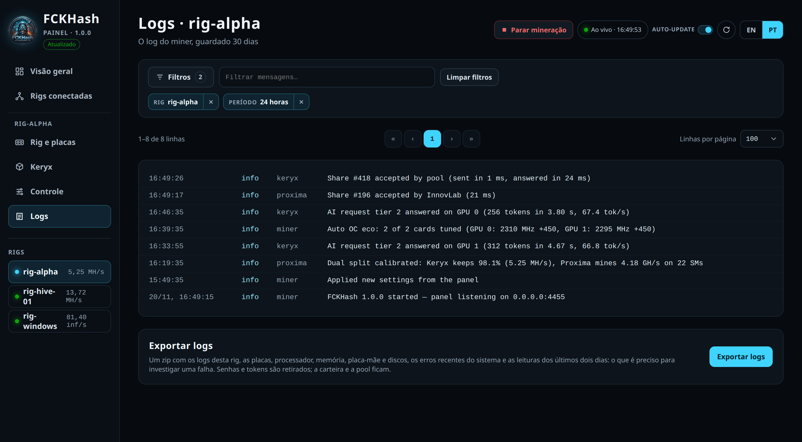

# Painel Web e Hub Multi-Rig

[English](../en/panel.md) · **Português (Brasil)** · [Voltar ao README](../../README.pt-BR.md)

Toda rig com FCKHash serve um painel web integrado na porta `4455` (`http://IP-DA-RIG:4455`), em
português e inglês, sem precisar instalar nenhum outro programa. Uma única rig pode acompanhar todas
as outras rigs da sua rede local ou Tailscale, guardar o histórico delas, alterar configurações e
overclock, e instalar atualizações na farm inteira a partir de uma aba do navegador ou app no
celular.

## Como abrir o painel

- **Em qualquer navegador na mesma rede:** abra `http://IP-DA-RIG:4455` (ou
  `http://localhost:4455` na própria máquina).
- **Pelo menu de aplicativos do desktop (Linux e Windows):** a primeira execução num desktop
  adiciona o **FCKHash Panel** ao menu de aplicativos do Linux ou ao Menu Iniciar do Windows, e você
  também pode rodar `./fckhash -open` (`fckhash.exe -open` no Windows) para abrir o painel numa
  janela própria.
- **Pelo Tailscale (4G/5G ou qualquer Wi-Fi):** abra `http://IP-TAILSCALE:4455` ou o nome da rig na
  Tailscale.
- **Mudar o endereço ou desligar:** passe `-panel localhost:4455` para deixar acessível só na
  própria máquina, ou `-panel off` para desligar. Veja [opções do miner](options.md).

O painel não tem senha por padrão para que qualquer aparelho da sua rede local ou Tailscale abra na
hora. Numa rede compartilhada com terceiros, restrinja com `-panel localhost:4455` ou `-panel off`.

---

## Assistente de Primeira Configuração (Passo a passo em 5 etapas)

Ao iniciar o FCKHash numa máquina Linux ou Windows nova (ou ao clicar em **Passo a passo** na aba
Controle), o assistente guia toda a configuração sem precisar editar arquivos `.sh` ou `.bat`:

1. **Moeda:** escolha qualquer moeda suportada (`keryxhash`, `vela`, `proxima`, `neb`, `numen`,
   `vearl`) e ative se quiser a **Mineração dupla** (`keryxhash` + `proxima` nas placas RTX 50).
2. **Pool e carteira:** alterne entre **Pool** e **Solo**, escolha uma pool conhecida com um clique
   e preencha sua carteira e nome do worker.
3. **Placas e auto OC:** escolha quais GPUs vão minerar, selecione **Auto · Eco**, **Auto · Boost**
   ou **Manual**, e adicione opções da moeda se precisar.
4. **Celular e rede:** busque automaticamente outras rigs na rede local e conecte o Tailscale para
   acesso pelo celular.
5. **Revisar e iniciar:** confira o resumo e clique em **Iniciar mineração**.

---

## Visão Geral e Hub Multi-Rig da Farm

Quando você conecta duas ou mais rigs, a aba **Visão geral** mostra a farm inteira no topo e a rig
selecionada logo abaixo:

- **Totais da farm:** hashrate somado de cada moeda na farm, rigs online, placas minerando, consumo
  total (W e kWh por dia) e a placa mais quente entre todas as rigs.
- **Hashrate por rig:** barra segmentada mostrando a participação (%) e a velocidade de cada rig em
  cada moeda.
- **Tabela de rigs e gráficos da última hora:** estado ao vivo, moeda, hashrate, consumo,
  temperatura mais alta, sistema operacional e rede (`LAN` ou `Tailscale`) de cada rig, além do
  gráfico individual da última hora de cada máquina.
- **Alertas com silenciamento (`Silenciar`):** avisos e problemas ativos aparecem no topo com
  contador. Um alerta que você já conhece pode ser **Silenciado** e reativado depois na lista de
  silenciados; a lista fica salva na rig, então o computador e o celular veem exatamente o mesmo
  estado.
- **Parar / Iniciar mineração:** o botão no topo pausa a mineração (devolvendo os clocks padrão das
  placas enquanto mantém o painel online) e volta a minerar com um clique.

---

## Rig e Placas e Gráficos Históricos (até 30 dias)

A aba **Rig e placas** mostra a telemetria ao vivo da rig escolhida e os gráficos históricos:

- **Indicadores ao vivo por moeda:** hashrate, modo pool/solo, porcentagem de shares aceitos,
  rejeitados e stale, tempo do último share, ping da pool e divisão da mineração dupla.
- **Tabela de placas:** modelo de cada GPU, hashrate (das duas moedas no modo dual, mais a
  eficiência), temperaturas de core e memória, ventoinha (%), consumo e % do power limit, uso da
  GPU, clocks de core e memória com lock/offset ativos, chip de estado do Auto OC (`Ajustada +14%`,
  `Ajustando 12/35`, `Manual`), resultados conferidos/errados e botão rápido de **Reajustar** ou
  **OC** manual.
- **Gráficos históricos interativos:** filtre entre **Todas as placas** ou uma GPU específica, e
  entre **1h**, **6h**, **24h**, **7d** e **30d**. As leituras são gravadas a cada 10 segundos na
  rig (e copiadas automaticamente para o Hub), mantendo o histórico completo mesmo com o navegador
  fechado.

---

## Aba Exclusiva da Moeda (Keryx: Pedidos de IA e Tiers)

Moedas com telemetria própria ganham uma aba dedicada na barra lateral. No **Keryx**, a aba
**Keryx** mostra:

- **Contadores principais:** pedidos de IA respondidos, recompensas de IA pagas (em solo), placas em
  quarentena e estado do certificado de escrow.
- **Placas e prontidão de IA:** o tier de mineração de cada placa, o que ela está fazendo no
  momento, o modelo de IA carregado na VRAM e a velocidade em tokens/s.
- **Pedidos de IA recentes:** os últimos 30 pedidos de IA com horário, tier, placa usada, tokens
  gerados, duração e resultado.

---

## Controle, Overclock Manual ao Vivo e Auto OC

A aba **Controle** configura a rig selecionada direto pelo navegador — na máquina local ou
remotamente pelo Hub:

- **Mineração e Mineração dupla:** troque de moeda, escolha presets de pools conhecidas com um
  clique, edite carteira, worker e senha, marque quais placas mineram, adicione opções validadas da
  moeda e configure a mineração dupla (`keryxhash` + `proxima`). Cada moeda lembra a pool e a
  carteira que você digitou para ela ao alternar entre moedas.
- **Um único painel de Overclock com três modos:**
  - **Auto · Eco:** encontra o melhor hashrate por watt em cada placa (limite de 70 °C no core e
    limite próprio na memória GDDR6X/GDDR7/HBM), com limite opcional de **Potência máxima (%)** e
    botão **Reajustar** por placa.
  - **Auto · Boost:** busca mais hashrate enquanto a energia extra ainda compensa (limite de 75 °C).
  - **Manual:** defina offset de core, lock de core, offset de memória, lock de memória, power limit
    (W) e ventoinha (%) para todas as placas de uma vez ou placa por placa, **salvo separadamente
    por moeda**. Ao alterar o overclock manual da moeda que está rodando enquanto o miner já está no
    modo Manual, **os novos clocks são aplicados nas placas na mesma hora, sem reiniciar o miner**.
- **Pedido automático de permissão no desktop:** no Linux e no Windows, se você ativar Auto OC ou
  clocks manuais sem estar como root / Administrador, o FCKHash abre automaticamente a janela de
  senha ou confirmação UAC e reinicia com permissão para aplicar os clocks.
- **Aviso de conflito no HiveOS:** no HiveOS, a aba Controle verifica se há perfil de OC ou autofan
  ativo no Hive e avisa quando houver conflito com o overclock do miner.

---

## Rigs Conectadas, Busca na Rede Local, Tailscale e Atualização em Lote

A aba **Rigs conectadas** transforma qualquer painel em uma central para toda a sua farm:

- **Descobrir rigs na rede local:** clique em **Buscar rigs na rede** para encontrar automaticamente
  outras máquinas rodando FCKHash na sua LAN ou Tailscale e adicioná-las com **Adicionar** ou
  **Adicionar todas**. Você também pode adicionar qualquer rig digitando o IP/nome e a porta
  (**Não encontrou sua rig? Adicione manualmente**).
- **Atualização da farm com 1 clique (`Instalar em todas as rigs`):** o FCKHash procura novas
  releases assinadas a cada 3 horas (ou no botão de busca na barra superior). No Linux e no Windows,
  você pode ligar a chave **Auto-update** no topo, clicar em **Instalar** numa rig ou usar o botão
  **Instalar em todas as rigs** na aba Rigs conectadas para atualizar todas as máquinas Linux e
  Windows da farm de uma só vez. Cada rig aguarda terminar qualquer pedido de IA em andamento,
  confere a assinatura criptográfica do pacote e volta sozinha para a versão anterior caso a versão
  nova não minere. No HiveOS, o painel fornece a nova Installation URL pronta para copiar na flight
  sheet.
- **Controle pelo celular (Tailscale) e instalação como App:** conecte o Tailscale pelo próprio
  painel e clique em **Criar o endereço HTTPS** para ativar o endereço seguro da rig na sua conta
  Tailscale. Abrindo esse endereço `https://...ts.net` no celular, o Chrome ou Safari instala o
  FCKHash Panel como aplicativo em tela cheia na tela inicial.

---

## Visão no Celular (App / PWA)

O painel foi desenhado tanto para o celular quanto para o desktop: as tabelas viram cartões
responsivos, o topo dá acesso rápido a **Parar / Iniciar mineração** e **Auto-update**, e o menu
lateral alterna rapidamente entre todas as rigs conectadas.

  

---

## Logs e Exportação de Diagnóstico em 1 Clique

A aba **Logs** exibe os últimos 30 dias de registros gravados na rig:

- Filtre por **Rig** (uma rig ou **Todas as rigs** juntas), **Período** (1h, 24h, 7d, 30d),
  **Nível** (Todos ou Avisos e erros) e **Moeda**, ou pesquise por texto.
- **Exportar logs:** baixa um único arquivo `.zip` com o `log.txt`, a tabela de logs de 30 dias, as
  leituras de placas e hashrate das últimas 48 horas e o diagnóstico da máquina (CPU, RAM,
  placa-mãe, discos, `nvidia-smi -q`, erros recentes de GPU/PCIe do sistema). Senhas, tokens de pool
  e certificados de escrow são removidos automaticamente antes de gerar o arquivo.

